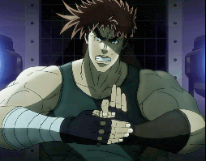
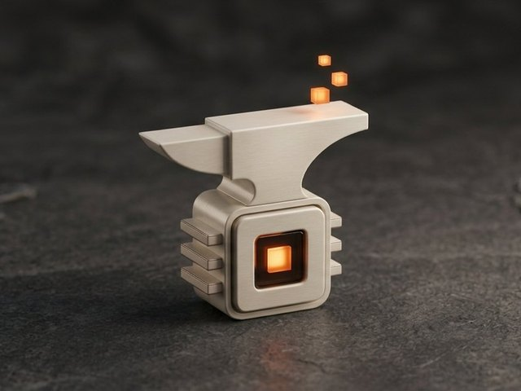
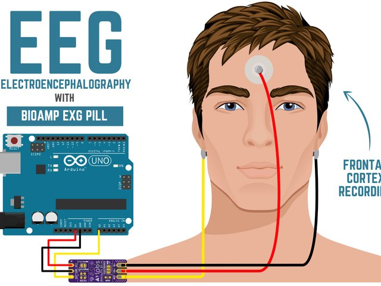
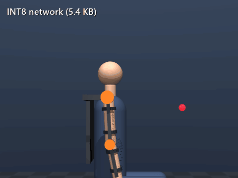
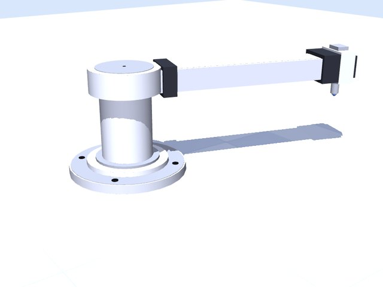

<p align="center">
  
</p>

<p align="center">
  
</p>

<p align="center">
  <a href="https://vasco1290.github.io"></a>
  <a href="https://linkedin.com/in/rawal-harshit"></a>
  <a href="mailto:harshitrawal.dev@gmail.com"></a>
</p>

---

## 🔌 Pinout

I'm an AI&ML graduate. I got curious about how the brain works and never quite recovered. I don't stick to one layer; I like building intelligent systems from the math to the metal. I am learning how to build stuff mostly in simulation, because hardware is expensive and I'm not. No GPU was harmed in the making of any of it, mostly because I don't own one.

<p align="center">
  
</p>

---

## 🔬 Specimens

<sub>Four things from the bench. Each one has a label: open it to see what's inside, and what isn't yet.</sub>

<table>
<tr>
<td width="50%" valign="top">

### [Brokkr](https://github.com/Vasco1290/Brokkr)
<a href="https://github.com/Vasco1290/Brokkr"></a>

*What happens to a model's sense of doubt when you shrink it, then blind it with fog?*

Shrinks image models to 8-bit, then stress-tests them with fog, darkness and blur. Each one gets a nutrition label showing what the shrinking cost.

<details>
<summary><code>read the label</code></summary>

```text
does              FP32 → INT8 (ONNX Runtime), then
                  12 kinds of damage
tested            10 torchvision models,
                  10k ImageNet val images
measures          accuracy, conformal coverage
                  + set size, ECE, E-AURC
found             the doubt signal mostly breaks
                  when conditions shift
──────────────────────────────────────────────
not yet           a real edge device, PyPI,
                  your own model (in progress)
```
[Live labels →](https://vasco1290.github.io/Brokkr/)
</details>

</td>
<td width="50%" valign="top">

### [MindNav](https://github.com/Sakib-Dalal/Mind-Nav)
<a href="https://github.com/Sakib-Dalal/Mind-Nav"></a>

*Typing without touching anything.*

Types words on screen from EEG signals picked up on the forehead, no hands needed. A team of four; I handled the neuroscience.

<details>
<summary><code>read the label</code></summary>

```text
hardware          Arduino Uno, amplifier board,
                  3 gel electrodes
signal            EEG, streamed to a laptop
does              hands-free on-screen typing
team              4 (final-year project)
──────────────────────────────────────────────
not yet           the paper; a device rebuilt
                  from scratch
```
</details>

</td>
</tr>
<tr>
<td width="50%" valign="top">

### [Quantized Arm Control](https://github.com/Vasco1290/quantized-arm-control-mcu)
<a href="https://github.com/Vasco1290/quantized-arm-control-mcu"></a>

*An arm that thinks in a quarter of the bits.*

A 5.4 KB network doing 8-bit maths steers a simulated exoskeleton arm and lands every reach. It holds at 6 bits and breaks at 4.

<details>
<summary><code>read the label</code></summary>

```text
sim               MuJoCo, 2-joint arm with gravity
controller        10 → 64 → 64 → 2 network,
                  INT8, 5.4 KB
result            100/100 reaches within 3 cm
precision         fine at 6 bits, breaks at 4
──────────────────────────────────────────────
not yet           running on a real Pi Zero W /
                  ESP32-S3 (loop is built)
```
</details>

</td>
<td width="50%" valign="top">

### [2-DOF Robotic Arm](https://github.com/Vasco1290/2-DOF-Robotic-Arm)
<a href="https://github.com/Vasco1290/2-DOF-Robotic-Arm"></a>

*You type. It reaches.*

Type `move TCP to x 0.1 y 0.3` and inverse kinematics swings the base and slides the arm to get there.

<details>
<summary><code>read the label</code></summary>

```text
joints            1 rotating + 1 sliding
sim               MuJoCo, Python
input             typed commands, joint or x/y/z
status            about halfway
──────────────────────────────────────────────
not yet           real hardware
```
</details>

</td>
</tr>
</table>

---

## 🛠️ Instruments

<table>
<tr><td><code>languages</code></td><td>
  
  
  
  
  
</td></tr>
<tr><td><code>ml</code></td><td>
  
  
  
  
  
</td></tr>
<tr><td><code>hardware</code></td><td>
  
  
  
  
  
</td></tr>
<tr><td><code>tools</code></td><td>
  
  
  
  
  
  
  
</td></tr>
</table>

<sub>Still tuning: Rust, MuJoCo, KiCad.</sub>

---

<details>
<summary><b>📈 Activity</b></summary>
<br/>
<p align="center">
  
</p>
</details>

<p align="center">
  
</p>
